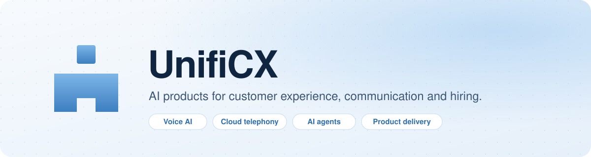

<picture>
  <source media="(prefers-color-scheme: dark)" srcset="./banner-dark.svg">
  
</picture>

  
  
  
  

 

## What we build

<table>
  <tr>
    <td width="33%" valign="top">
      <h3><a href="https://platform.unificx.com">UnifiCX Platform</a></h3>
      
One portal for business communication: phone numbers and cloud PBX, voice AI agents, chatbots, knowledge bases and call intelligence, with billing built in.

      <code>Voice AI</code> · <code>Telephony</code> · <code>Call analytics</code>
    </td>
    <td width="33%" valign="top">
      <h3><a href="https://screenpilot.unificx.com">ScreenPilot</a></h3>
      
Candidate intelligence for recruiters. CVs, AI voice interviews and recruiter notes become evidence-backed profiles that can be matched against any job, now or later.

      <code>Recruiting</code> · <code>AI interviews</code> · <code>Matching</code>
    </td>
    <td width="33%" valign="top">
      <h3><a href="https://devstudio.origen.co">Origen Dev Studio</a></h3>
      
Takes product ideas from brief to release. AI agents draft the specs, designs and engineering plan, and people review and approve every step.

      <code>Product</code> · <code>Design</code> · <code>Engineering</code>
    </td>
  </tr>
</table>

## How we work

- **People approve, AI drafts.** Agents do the groundwork; every decision that matters has a person behind it.
- **Secure by default.** Isolated customer data, encrypted secrets, two-step sign-in.
- **Ship small, ship often.** Every change is tested and deployed continuously.

## Built with

  
  
  
  
  
  
  
  

---

  Our repositories are private. Working with us and need access? Ask an organization owner.

